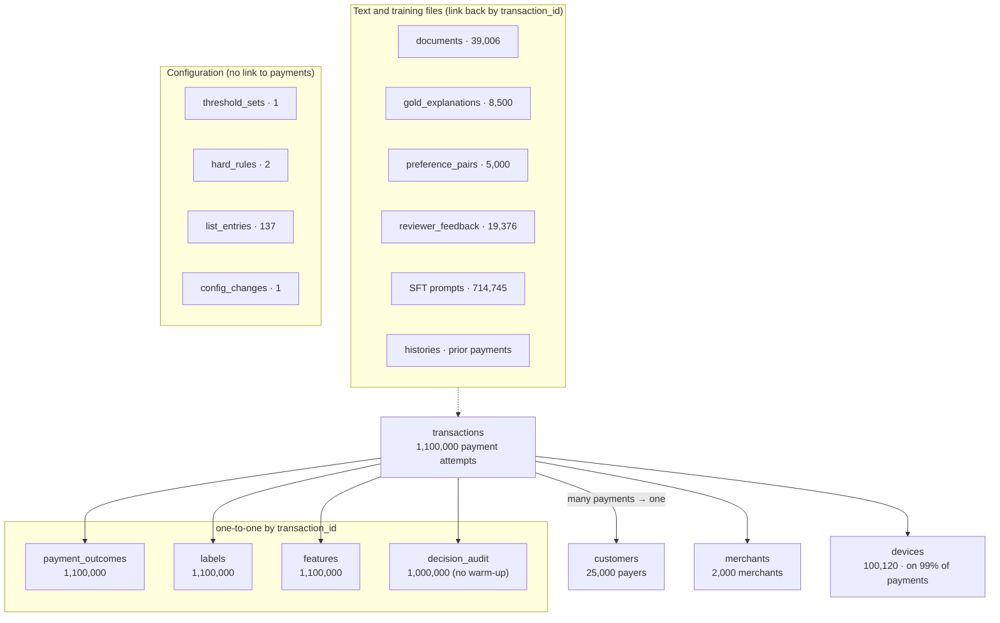

# Project Dataset Understanding

*Oct 16, 2026 · @Saurabh*

## Contents

1. [Dataset overview](#1-dataset-overview)
2. [Data dictionary](#2-data-dictionary)
3. [Business mapping](#3-business-mapping)
4. [Patterns, trends and insights](#4-patterns-trends-and-insights)
5. [Data quality observations](#5-data-quality-observations)
6. [AI/ML opportunities](#6-aiml-opportunities)
7. [Discussion notes](#7-discussion-notes)
8. [Individual contributions](#8-individual-contributions)

---

## 1. Dataset overview

The project dataset is a **synthetic (fictional) teaching dataset of 1,100,000 Indian digital payments** (1,000,000 main + 100,000 warm-up), with fraud labels, pre-computed features, simulated decisions, investigator text and LLM training files. It exists to build and test the project real-time fraud scorer described in the CRD, HLD and LLD. Generator version 1.0.1, seed `20261010`, label snapshot 1 May 2026.

**Business problem:** decide in real time whether each payment should be **ALLOWED**, sent to **REVIEW** or **BLOCKED**, and explain why, while catching rare fraud (0.6% of payments) without annoying genuine customers.

**What one record represents:** one payment authorisation attempt by a customer, at a merchant, from a device, at a moment in time, plus everything learned about it (its outcome, its fraud label 60 days later, its features, the system's decision).

### Size and structure

The folder is about **750 MB**: 18 relational tables (as gzipped CSV, plus Parquet for transactions), JSONL files for histories and LLM training, and Markdown documents. Most tables are split by time into train, validation and holdout; only `transactions`, `payment_outcomes`, `labels` and `features` also have a warm-up part (Oct–Dec 2024 payments that give customers history before January 2025), and reference tables like `customers` and `merchants` are not split.

| Area (folder) | Contents | Records | Format |
|---|---|---|---|
| `tables/` | 18 relational tables (customers, transactions, features, labels, decisions, rules, text metadata) | see below | CSV.gz |
| `parquet/transactions/` | Same transactions joined with their labels: 19 columns (no `merchant_id`; adds `fraud_label` and `label_available_at`) | 1,100,000 | Parquet (52 files) |
| `histories/` | Last ≤ 20 prior payments per transaction (what Redis would hold) | one per transaction | JSONL.gz |
| `training/` | SFT prompts, CPT corpus, DPO pairs, gold explanations, fmt-v1 vs fmt-v2 comparison | 714,745 SFT train rows; 5,000 DPO; 8,000 gold | JSONL.gz |
| `corpus/` | Investigator notes, chargeback narratives, playbooks, synthetic RBI exercises, guidelines | 39,006 | JSONL.gz |
| `documents/` | Human-readable Markdown copies of a sample of the corpus | 1,525 files | .md |
| `ground_truth/` | Generator scenario per event (evaluation only, never a model input) | 1,100,000 | JSONL.gz |
| `evaluation/` | 500-case holdout explanation pack | 500 | JSONL.gz |
| `sql/` | Postgres schema, indexes, validation queries, training-role example | 4 scripts | .sql |
| Root files | Data card, data dictionary, feature catalogue, manifest, quality report, rules config, requirement coverage | 10 files | .md / .json |

### Record counts per table

| Table | Rows | Columns | Split |
|---|---:|---:|---|
| transactions | 1,100,000 | 18 | warm-up 100,000 · train 714,745 · validation 144,803 · holdout 140,452 |
| payment_outcomes | 1,100,000 | 5 | same as transactions |
| labels | 1,100,000 | 7 | same as transactions |
| features | 1,100,000 | 22 | same as transactions |
| decision_audit | 1,000,000 | 18 | main splits only |
| devices | 100,120 | 3 | all |
| document_chunks | 78,007 | 8 | train / validation / holdout |
| documents | 39,006 | 16 | train / validation / holdout |
| customers | 25,000 | 6 | all |
| reviewer_feedback | 19,376 | 7 | train / validation / holdout |
| gold_explanations | 8,500 | 8 | train 8,000 · holdout 500 |
| preference_pairs | 5,000 | 9 | train |
| merchants | 2,000 | 5 | all |
| legacy_cases | 2,000 | 9 | all (2021–2024 archive) |
| list_entries | 137 | 6 | all |
| hard_rules | 2 | 7 | all |
| threshold_sets | 1 | 8 | all |
| config_changes | 1 | 9 | all |

Across the 18 tables there are **171 attributes**. Data types present: text IDs, integers, decimals, UTC timestamps, Booleans, JSON objects (locations, reason codes, request snapshots) and free text.

### Time splits (IST)

| Split | Period | Rows | Fraud | Fraud rate |
|---|---|---:|---:|---:|
| Warm-up | Oct–Dec 2024 | 100,000 | 600 | 0.60% |
| Train | Jan–Oct 2025 | 714,745 | 4,236 | 0.59% |
| Validation | Nov–Dec 2025 | 144,803 | 928 | 0.64% |
| Holdout | Jan–Feb 2026 | 140,452 | 836 | 0.60% |

### How the tables relate

`transactions` is the centre. Each transaction points to one customer, one merchant and (99% of the time) one device. Four tables share its `transaction_id` one-to-one: `payment_outcomes`, `labels`, `features` and `decision_audit`. Text and training tables (documents, gold explanations, preference pairs, reviewer feedback, SFT prompts, histories) also link back by `transaction_id`. Rules tables (`threshold_sets`, `hard_rules`, `list_entries`, `config_changes`) stand alone as configuration. Every foreign key checked resolves: **0 orphan** customer, merchant or device IDs.

*Source: `data_dictionary.json`, `manifest.json` and foreign-key checks.*

Read it top to bottom: many payments point up to one customer, merchant and device; four tables sit one-to-one under each payment; text and training files link back by `transaction_id`; the configuration box has no link to payments at all.

---

## 2. Data dictionary

Every attribute of every table is listed below with its type, business meaning, observed values and its role in the project. Types are the Postgres types from `data_dictionary.json`; values are measured from the full data. `is_synthetic` appears in every table and is always `true` (a flag marking the row as fictional); it is listed once here and not repeated.

Under each table is **one real example row** taken from the files. Where tables link, the examples follow the same payment, **`TX_0000100016`**: a ₹1,418.66 wallet payment for electronics at 00:10 IST on 1 Jan 2025. It was later confirmed as fraud, but the simulated system allowed it. Timestamps are stored in UTC; the IST time is shown in brackets.

### 2.1 customers (25,000 rows) — one row per payer

**What it is:** One row per person who pays: when they opened their account, their age, home city and region. Payments link here by `customer_id`, so you can ask whether a payment looks normal for this person.

| Attribute | Type | Business meaning | Observed values | Use in project |
|---|---|---|---|---|
| customer_id | text, PK | Pseudonymised customer code | `C_` + 16 hex chars; 25,000 unique | Joins to transactions; Redis key for history and velocity |
| created_at | timestamptz | When the account was opened | 1 Jan 2020 to 27 Feb 2026 (IST) | Source of account age (FE-06) |
| customer_age | integer | Customer age in years | 18–80, median 49 | Model input; fairness checks by age band |
| home_city | text | Customer's home city | 16 cities, ~1,550 each (Kochi, Delhi, Lucknow…) | Baseline for new-city / geo checks |
| region | text | Indian region | east 6,261 · south 6,236 · north 4,765 · west 4,669 · northeast 1,541 · central 1,528 | Fairness checks by region (FR-ML-11) |
| is_synthetic | boolean | Row is fictional | always true | Data-governance marker |

**Example row** (the payer of TX_0000100016)

| Column | Example value | What it tells you |
|---|---|---|
| customer_id | `C_625a6f3e64f87d0f` | Pseudonymous ID for this payer |
| created_at | `2023-06-29T18:30:00Z` (30 Jun 2023, 00:00 IST) | Account opened 551 days before the payment |
| customer_age | 62 | Age in years |
| home_city | Guwahati | Usual city of the payer |
| region | northeast | Region of the home city |
| is_synthetic | true | Fictional record |

### 2.2 merchants (2,000 rows) — one row per merchant

**What it is:** One row per shop or service that receives money, with its category (for example electronics or gaming) and city. The category matters most: gift cards, gaming and electronics hold 97% of the fraud.

| Attribute | Type | Business meaning | Observed values | Use in project |
|---|---|---|---|---|
| merchant_id | text, PK | Merchant code | `M_` + 16 hex; 2,000 unique | Joins to transactions; allowlist target |
| synthetic_name | text | Fictional merchant name | "Synthetic Merchant 000000"… | Display only; not a model input |
| merchant_category | text | Merchant category (MCC group) | 10 groups, 200 merchants each: grocery, food, education, travel, electronics, gaming, gift_cards, quick_commerce, healthcare, other | Strong risk signal; per-MCC thresholds (FR-RE-04); FE-08 |
| merchant_location | JSON | Merchant city, latitude, longitude | 16 cities, 125 merchants each | Distance and geo-mismatch features (FE-03) |

**Example row** (the merchant paid in TX_0000100016)

| Column | Example value | What it tells you |
|---|---|---|
| merchant_id | `M_aad2c9114ea977bf` | Merchant code |
| synthetic_name | Synthetic Merchant 000154 | Placeholder name, no real brand |
| merchant_category | electronics | One of the three high-fraud categories |
| merchant_location | `{"city":"Kochi","lat":9.93,"lon":76.27}` | City and coordinates of the merchant |
| is_synthetic | true | Fictional record |

### 2.3 devices (100,120 rows) — one row per device fingerprint

**What it is:** One row per phone or browser used to pay, saying whether it is a mobile app or a web browser. It lets you spot a device that is new for a customer, or one device shared by many customers, which is a strong fraud signal.

| Attribute | Type | Business meaning | Observed values | Use in project |
|---|---|---|---|---|
| device_id | text, PK | Device fingerprint code | `D_` + 16 hex; 100,120 unique (53,018 used in transactions) | New-device (FE-02), device sharing (FE-09), blocklist |
| device_kind | text | Type of device | mobile 75,090 · browser 25,030 | Possible model input / segment |

**Example row** (the phone used for TX_0000100016)

| Column | Example value | What it tells you |
|---|---|---|
| device_id | `D_3cdd123ac0cca915` | Device fingerprint |
| device_kind | mobile | A phone app, not a browser |
| is_synthetic | true | Fictional record |

### 2.4 transactions (1,100,000 rows) — one row per payment attempt

**What it is:** One row per payment attempt: who paid whom, how much, when, from where, by which channel and on which device. It is the central table; every other payment table joins to it by `transaction_id`.

This is the core table: the request the Payment API sends (CRD §10.2) plus the historical fields the feature store supplies.

| Attribute | Type | Business meaning | Observed values | Use in project |
|---|---|---|---|---|
| transaction_id | text, PK | Unique payment ID | `TX_` + 10 digits; 1,100,000 unique, 0 duplicates | Join key to every other table; audit ID |
| customer_id | text, FK | Who paid | 24,834 distinct customers; busiest has 109 payments | Lookup of history, velocity, allowlist |
| merchant_id | text, FK | Who was paid | 2,000 distinct; busiest 1,161 payments | Merchant risk, allowlist |
| device_id | text, FK, nullable | Device used | 53,018 distinct; 10,683 null (0.97%) | New device, device sharing, blocklist; null → `unk` |
| amount_paise | bigint | Amount in paise (authoritative) | 217 to 798,733,717 (₹2.17 to ₹79.9 lakh); median ₹1,250.64 | Amount and amount-spike features; integer avoids rounding errors |
| transaction_amount | numeric(14,2) | Same amount in rupees | always equals amount_paise ÷ 100 (0 mismatches) | API-edge field; redundant with amount_paise |
| payment_channel | text | How the payment was made | UPI 637,591 · card 341,229 · wallet 76,510 · net_banking 44,670 | Model input; weak fraud signal |
| merchant_category | text | Merchant group (copied from merchant) | 10 groups; grocery largest (203,387) | Strongest single fraud signal; per-MCC thresholds |
| transaction_time | timestamptz (UTC) | When the payment was attempted | 1 Oct 2024 – 28 Feb 2026 IST; unique per row | Hour, night flag, split assignment, velocity windows |
| customer_age | integer | Customer age at payment | 18–80, median 49; matches customers table 100% | Model input; fairness |
| customer_location | JSON, nullable | Customer city + lat/lon | 16 cities; 33,067 null (3.0%) | Distance and new-city features; null → `unk` |
| merchant_location | JSON | Merchant city + lat/lon | 16 cities, never null | Distance feature |
| account_age | integer (days) | Days since account opened | 0–2,249, median 754 | New-account flag (< 30 days) |
| previous_transactions | integer | Customer's prior payments in the last 30 days (feature-store field) | 0–35, median 3 | History depth; cold-start detection |
| average_transaction_value | numeric, nullable | Customer's average amount over the preceding 90 days, in rupees | ₹12.97 to ₹76.8 lakh; 28,325 null (2.6%) = no history | Amount-to-average ratio (FE-01) |
| failed_transactions | integer | Failed attempts in the preceding 24 hours | 0–9; 0 for 85% of rows | Failure features (FE-05); strong signal |
| split | text | Which time split the row belongs to | warm-up / train / validation / holdout | Prevents leakage; never a model input |

**Example row** (TX_0000100016)

| Column | Example value | What it tells you |
|---|---|---|
| transaction_id | `TX_0000100016` | This payment |
| customer_id | `C_625a6f3e64f87d0f` | Who paid (row in customers) |
| merchant_id | `M_aad2c9114ea977bf` | Who was paid (row in merchants) |
| device_id | `D_3cdd123ac0cca915` | Which phone was used (row in devices) |
| amount_paise | 141866 | ₹1,418.66 in paise |
| transaction_amount | 1418.66 | Same amount in rupees |
| payment_channel | wallet | Paid from a digital wallet |
| merchant_category | electronics | Copied from the merchant |
| transaction_time | `2024-12-31T18:40:47.105Z` | 1 Jan 2025, 00:10 IST: just after midnight |
| customer_age | 62 | Copied from the customer |
| customer_location | `{"city":"Chennai","lat":13.08,"lon":80.27}` | Paid from Chennai, not the home city Guwahati |
| merchant_location | `{"city":"Kochi","lat":9.93,"lon":76.27}` | Merchant is in Kochi, 559 km away |
| account_age | 551 | Account is 551 days old |
| previous_transactions | 3 | Three earlier payments in the last 30 days |
| average_transaction_value | 628.52 | Average past payment ₹628.52 |
| failed_transactions | 1 | One failed attempt in the last 24 hours |
| split | train | Falls in the training period |
| is_synthetic | true | Fictional record |

### 2.5 features (1,100,000 rows) — the 10 engineered features FE-01 to FE-10 per payment

**What it is:** For each payment, ready-made signals calculated from the customer's past, such as "2.3 times the usual amount", "new device" or "paid at night". These are what a model actually reads, and they decide which reason codes fire.

All features are computed at authorisation, from history before the current payment (point-in-time), so they are safe to use for training.

| Attribute | Type | Business meaning | Observed values | Use in project |
|---|---|---|---|---|
| transaction_id | text, PK/FK | Payment the features belong to | 1:1 with transactions | Join key |
| feature_as_of | timestamptz | Moment the features were computed (= transaction time) | unique per row | Proves no future data used |
| amount_to_avg_ratio | double, nullable | FE-01: amount ÷ 90-day average | 0–32,318, median 0.75; 28,325 null (no history) | Amount-spike signal (R05) |
| is_new_device | boolean, nullable | FE-02: device not seen for this customer in 90 days | true 72,418 · false 1,016,899 · null 10,683 | New-device signal (R01) |
| customer_merchant_distance_km | double, nullable | FE-03: straight-line (haversine) distance | 0–2,429 km, median 1,082; 33,067 null | Geo signal (R02) |
| is_new_city | boolean, nullable | FE-03: city not seen in 90 days | true 76,679 · null 33,067 | Geo signal |
| hour_of_day | integer | FE-04: IST hour | 0–23, hour 5 never occurs | Time-of-day signal |
| is_night | boolean | FE-04: 00:00–05:00 IST | true 155,633 (14%) | Odd-hour signal (R03) |
| has_recent_failures | boolean | FE-05: ≥ 3 failed attempts in 24 h | true 98,634 (9%) | Failure signal (R04) |
| is_new_account | boolean | FE-06: account younger than 30 days | true 11,541 (1%) | New-account signal (R06) |
| txn_count_last_1h | integer | FE-07: prior attempts in the last hour (declines included) | 0–17; 0 for 57% | Velocity signal (R07) |
| txn_amount_last_24h_paise | bigint | FE-07: amount attempted in the last 24 h | 0 to ₹80 lakh; median 0 | Velocity signal |
| distinct_customers_per_device_7d | integer, nullable | FE-09: other customers seen on this device in 7 days | 0–8; 10,683 null | Device-sharing / mule signal |
| combined_risk_flags | integer | FE-10: count of device, geo, night, failure and new-account flags | 0–4; 1 for 65% | Simple combined risk score |
| mcc_target_encoded_rate | double | FE-08: smoothed past fraud rate of the merchant category | 0.00003–0.027 | Category risk without leaking future labels |
| mcc_encoding_as_of | timestamptz | Month-end date of the labels used for FE-08 | 14 month-ends; frozen at 1 Nov 2025 IST for validation/holdout | Leakage control |
| mcc_encoding_count | integer | Number of labelled payments behind FE-08 | 0–105,167 | Confidence in FE-08 |
| missing_customer_location | boolean | Location was absent | true 33,067 | Explicit missing flag |
| missing_device | boolean | Device was absent | true 10,683 | Explicit missing flag |
| cold_start | boolean | Customer had no 90-day history | true 28,325 | Explains null FE-01 |
| reason_codes | JSON list | Rule-derived weak reason labels | 0–7 codes per row; `[]` for 120,818 rows | Training target for the 8 reason heads |
| feature_version | text | Version of the feature code | always `project-features-1.0.0` | Reproducibility, training-serving parity |

**Example row** (features of TX_0000100016)

| Column | Example value | What it tells you |
|---|---|---|
| transaction_id | `TX_0000100016` | The payment these features describe |
| feature_as_of | `2024-12-31T18:40:47.105Z` | Computed at the moment of the payment, using only earlier data |
| amount_to_avg_ratio | 2.2571 | ₹1,418.66 ÷ ₹628.52: about 2.3 times the usual amount |
| is_new_device | false | This phone was seen 42 seconds earlier |
| customer_merchant_distance_km | 559.09 | Chennai to Kochi |
| is_new_city | false | Chennai was already in the history |
| hour_of_day | 0 | Midnight hour in IST |
| is_night | true | Between 00:00 and 05:00 IST |
| has_recent_failures | false | Only 1 failure in 24 hours; the flag needs 3 |
| is_new_account | false | 551 days old, not under 30 |
| txn_count_last_1h | 1 | One payment in the previous hour (TX_0000100013) |
| txn_amount_last_24h_paise | 36858 | ₹368.58 spent in the previous 24 hours |
| distinct_customers_per_device_7d | 1 | Only this customer used the phone |
| combined_risk_flags | 2 | Two risk flags raised together |
| mcc_target_encoded_rate | 0.006 | Historical fraud rate used for electronics |
| mcc_encoding_as_of | `2024-12-31T18:30:00Z` | Rate frozen at 1 Jan 2025, 00:00 IST |
| mcc_encoding_count | 0 | No mature labels behind the rate yet; 0.006 equals the overall 0.6% fraud rate |
| missing_customer_location | false | Location present |
| missing_device | false | Device present |
| cold_start | false | The customer has history |
| reason_codes | `["R02_GEO_MISMATCH","R03_ODD_HOUR","R08_HIGH_RISK_MCC"]` | Three reason codes fired (see 2.6) |
| feature_version | `project-features-1.0.0` | Version of the feature code |

### 2.6 Reason codes R01–R08

**What it is:** Not a file of its own, but a fixed list of eight short labels that say why a payment looks risky, such as `R03_ODD_HOUR`. Each payment carries the codes that fired, and they feed the explanation shown to analysts.

The empty `reason code.docx` in the root can be filled from this table. Names come from the data; meanings from the explanation templates.

| Code | Meaning (template wording) | Rows flagged (features) |
|---|---|---:|
| R01_NEW_DEVICE | Device not observed for this customer in the preceding 90 days | 72,418 |
| R02_GEO_MISMATCH | Unusual observed city or customer-to-merchant distance above 500 km | 895,465 |
| R03_ODD_HOUR | Authorisation requested between midnight and 05:00 IST | 155,633 |
| R04_FAILED_ATTEMPTS | At least three failed payment outcomes in the preceding 24 hours | 98,634 |
| R05_AMOUNT_SPIKE | Amount is at least five times the observed 90-day average | 30,690 |
| R06_NEW_ACCOUNT | Account age is below 30 days | 11,541 |
| R07_VELOCITY | At least four prior authorisations in the preceding hour | 148,480 |
| R08_HIGH_RISK_MCC | Elevated category flag under the synthetic teaching policy | 324,094 |

**Example** (which codes fired for TX_0000100016)

| Code | Fired? | Why |
|---|---|---|
| R01_NEW_DEVICE | No | The phone was used 42 seconds earlier |
| R02_GEO_MISMATCH | **Yes** | Customer to merchant distance 559 km, above 500 |
| R03_ODD_HOUR | **Yes** | 00:10 IST is between midnight and 05:00 |
| R04_FAILED_ATTEMPTS | No | 1 failure in 24 hours; needs 3 |
| R05_AMOUNT_SPIKE | No | 2.3 times the average; needs 5 |
| R06_NEW_ACCOUNT | No | 551 days old; needs under 30 |
| R07_VELOCITY | No | 1 payment in the past hour; needs 4 |
| R08_HIGH_RISK_MCC | **Yes** | Electronics is on the high-risk category list |

### 2.7 labels (1,100,000 rows) — the fraud answer for each payment

**What it is:** The answer key: for each payment, whether it turned out to be fraud, how that was confirmed and the date the answer became known. The model learns to predict `fraud_label`; the date stops it learning from answers that were not yet known.

| Attribute | Type | Business meaning | Observed values | Use in project |
|---|---|---|---|---|
| transaction_id | text, PK/FK | Payment being labelled | 1:1 with transactions | Join key |
| fraud_label | smallint (0/1) | Was it fraud? | 1 = 6,600 (0.6%) · 0 = 1,093,400 | The prediction target |
| label_source | text | How the label was decided | mature_no_fraud 1,093,400 · investigator_verdict 5,185 · confirmed_chargeback 1,415 | Label quality; chargebacks are strongest evidence |
| label_available_at | timestamptz | When the label became known | always exactly 60 days after the payment | Label-maturity rule; time-split training |
| split | text | Time split | as transactions | Leakage control |
| eligible_at_next_split_start | boolean | Was the label already known when the next split began? | true 814,860 · false 285,140 (train 80% true, validation 2% true) | Strict historical simulation; calibration choice |

**Example row** (label of TX_0000100016)

| Column | Example value | What it tells you |
|---|---|---|
| transaction_id | `TX_0000100016` | The payment being labelled |
| fraud_label | 1 | It was fraud |
| label_source | investigator_verdict | A fraud analyst confirmed it |
| label_available_at | `2025-03-01T18:40:47.105Z` | Answer known on 2 Mar 2025 (IST), 60 days after the payment |
| split | train | Training period |
| eligible_at_next_split_start | true | Already known when validation began on 1 Nov 2025, so it can be used for training |
| is_synthetic | true | Fictional record |

### 2.8 payment_outcomes (1,100,000 rows) — what happened to each payment

**What it is:** What happened after each payment was sent for authorisation: success or failure, and how quickly. Failed attempts feed the "recent failures" signal (R04).

| Attribute | Type | Business meaning | Observed values | Use in project |
|---|---|---|---|---|
| transaction_id | text, PK/FK | Payment | 1:1 with transactions | Join key |
| outcome_time | timestamptz | When the outcome arrived | 0.05–2 s after the payment | Feature updater ordering (only past outcomes count) |
| status | text | Payment result | SUCCESS 981,435 · FAILED 118,565 (10.8%) | Feeds failed-attempt counters (FE-05) |
| failure_code | text, nullable | Why it failed | `SIMULATED_AUTH_FAILURE` when FAILED, else null (89%) | Failure detail; null is expected, not missing |

**Example row** (outcome of TX_0000100016)

| Column | Example value | What it tells you |
|---|---|---|
| transaction_id | `TX_0000100016` | The payment |
| outcome_time | `2024-12-31T18:40:48.384Z` | Result came back 1.3 seconds after the request |
| status | FAILED | The payment did not go through |
| failure_code | SIMULATED_AUTH_FAILURE | Generic simulated authorisation failure |
| is_synthetic | true | Fictional record |

### 2.9 ground_truth (1,100,000 JSONL records) — generator scenario

**What it is:** The generator's private notes on which scenario produced each event: normal behaviour or a sudden change of context. It is only for checking how the dataset was made and **must never be given to a model**.

| Field | Type | Meaning | Observed values | Use in project |
|---|---|---|---|---|
| event_number | integer | Event sequence number | 1–1,100,000 | Join to the event |
| scenario | text | Pattern the simulator generated | routine_or_legitimate_variation 923,633 · context_shift_burst 176,367 | Evaluation and analysis only — never a model input |
| split | text | Time split | as transactions | — |
| use | text | Usage rule | always `generator_evaluation_only_never_model_input` | Governance reminder |

**Example record** (the first line of the file; records hold no transaction ID)

| Field | Example value | What it tells you |
|---|---|---|
| event_number | 1 | First event the generator produced |
| scenario | routine_or_legitimate_variation | The generator meant this as normal behaviour |
| split | warmup | Warm-up period |
| use | generator_evaluation_only_never_model_input | Only for checking the generator; never a model input |

### 2.10 decision_audit (1,000,000 rows) — a simulated record of every decision

**What it is:** A log of what the fraud system decided for each main payment: the score, risk level, ALLOW / REVIEW / BLOCK, reasons, explanation, timings and the exact inputs used. It shows what a real audit record looks like and gives a baseline to beat, since it let 89% of fraud through.

This mirrors the 5-year audit record in LLD §3.3. All scores and decisions here come from a simple heuristic labelled `SYNTHETIC-HEURISTIC-NOT-A-MODEL-v1`, not a trained model.

| Attribute | Type | Business meaning | Observed values | Use in project |
|---|---|---|---|---|
| transaction_id | text, PK/FK | Payment decided | 1:1 with main transactions | Join key |
| scored_at | timestamptz | When it was scored | = transaction time | Audit trail |
| fraud_probability | numeric(7,6) | Simulated fraud score | 0.0074–0.88, median 0.021 | Example of the API field; not calibrated, never a feature |
| decision | text | ALLOW / REVIEW / BLOCK | ALLOW 981,690 · REVIEW 11,644 · BLOCK 6,666 | Shows the decision mix (MLOPS-01) |
| risk_level | text | Risk band | LOW 937,304 · MEDIUM 50,489 · HIGH 12,180 · CRITICAL 27 | Shows band → decision mapping |
| reason_codes | JSON list | Reasons returned | up to 3 codes | Example of API output |
| explanation | text | Plain-English reason | 85 template sentences | Template fallback examples |
| decision_source | text | Who decided | MODEL 993,360 · HARD_RULE 6,640 | FR-RE-05 example |
| model_version | text | Model that scored it | always the heuristic label | Audit field |
| rules_version | text | Rules active | always `synthetic-rules-1` | Audit field |
| latency_ms | integer | Simulated decision time | 20–220 ms, median 120 | Example only; not real performance |
| explanation_latency_ms | integer | Simulated explanation time | 20–1,720 ms, median 870 | Example only |
| prompt_format | text | Prompt format used | always fmt-v1 | Audit field |
| prompt_hash | text | SHA-256 fingerprint of the prompt | 64 hex chars | Prove which prompt was used without storing it |
| request | JSON | Request exactly as received | CRD §10.2 fields | Replay and audit |
| feature_vector | JSON | Feature values used | FE-01 to FE-10 | Replay and audit |
| split | text | Time split | train / validation / holdout | — |

**Example row** (decision for TX_0000100016: a fraud payment the heuristic missed)

| Column | Example value | What it tells you |
|---|---|---|
| transaction_id | `TX_0000100016` | The payment scored |
| scored_at | `2024-12-31T18:40:47.105Z` | Scored at the payment time |
| fraud_probability | 0.066175 | About 7% fraud risk, below the 0.30 MEDIUM cut-off |
| decision | ALLOW | Let through, although it was fraud |
| risk_level | LOW | Band for a score under 0.30 |
| reason_codes | `["R02_GEO_MISMATCH","R03_ODD_HOUR","R08_HIGH_RISK_MCC"]` | Codes shown with the decision |
| explanation | "Unusual observed city or customer to merchant distance above 500 km; Authorisation requested between midnight and 05:00 IST; Elevated category flag …" | Template text built from the codes |
| decision_source | MODEL | Decided by the score, not a hard rule |
| model_version | SYNTHETIC-HEURISTIC-NOT-A-MODEL-v1 | A simple heuristic, not a trained model |
| rules_version | synthetic-rules-1 | Rules in force |
| latency_ms | 41 | Scoring took 41 ms |
| explanation_latency_ms | 746 | Explanation took 746 ms |
| prompt_format | fmt-v1 | Prompt layout used |
| prompt_hash | `10be16a0…3eca` (64 hex characters) | Fingerprint of the exact prompt |
| request | `{"transaction_id":"TX_0000100016","transaction_amount":1418.66,"merchant_category":"electronics",…}` | The 10 request fields the API received |
| feature_vector | `{"amount_to_avg_ratio":2.2571,"is_night":true,…}` | The features used, copied from 2.5 |
| split | train | Training period |
| is_synthetic | true | Fictional record |

### 2.11 Rules and configuration tables

**What it is:** Settings, not payments: the score cut-offs for each risk level, hard rules such as "always block a blocklisted device", the block and allow lists, and a log of who changed what. The rules engine reads these to turn a score into a decision.

| Table.attribute | Type | Meaning | Observed values |
|---|---|---|---|
| threshold_sets.threshold_id | text, PK | Threshold set name | THR_DEFAULT_V1 |
| threshold_sets.version | integer | Version number | 1 |
| threshold_sets.mcc_group | text, nullable | Merchant group it applies to | null = default for all |
| threshold_sets.medium_from / high_from / critical_from | numeric(4,3) | Probability cut-offs for MEDIUM / HIGH / CRITICAL | 0.30 / 0.60 / 0.85 |
| threshold_sets.status | text | Lifecycle state | active_synthetic |
| hard_rules.rule_id / code | text | Rule name | HR_BLOCKLIST_DEVICE, HR_ALLOWLIST_CUSTOMER |
| hard_rules.expression | JSON | Safe rule condition | device_id in_list blocked_devices; customer_id in_list allowlisted_customers |
| hard_rules.action | text | What the rule does | BLOCK; CAP_AT_REVIEW |
| hard_rules.priority | integer | Which rule wins | 100 (block) beats 10 (allowlist) |
| hard_rules.enabled | boolean | On/off | both on |
| list_entries.entry_id | text, PK | List row ID | 137 entries |
| list_entries.list_type | text | Which list | blocked_devices 12 · allowlisted_customers 125 |
| list_entries.entity_id | text | Device or customer on the list | `D_…` / `C_…` |
| list_entries.effective_from | timestamptz | Start date | 1 Jan 2025 IST |
| list_entries.reason | text | Why listed | "fictional seeded policy fixture" |
| config_changes.change_id | text, PK | Change ID | CHANGE_0001 |
| config_changes.entity / entity_id | text | What was changed | threshold_sets / THR_DEFAULT_V1 |
| config_changes.before_value / after_value | JSON | Values before and after | null → {medium 0.3, high 0.6, critical 0.85} |
| config_changes.changed_by / changed_at / reason | text, timestamptz, text | Who, when, why | SYNTHETIC_ADMIN, 1 Jan 2025 IST, "Initial CRD teaching thresholds" |

**One example row from each table**

| Table | Example row | What it tells you |
|---|---|---|
| threshold_sets | THR_DEFAULT_V1 · version 1 · mcc_group empty · medium_from 0.300 · high_from 0.600 · critical_from 0.850 · active_synthetic | Default cut-offs for every category: 0.30 MEDIUM, 0.60 HIGH, 0.85 CRITICAL |
| hard_rules | HR_BLOCKLIST_DEVICE · `{"field":"device_id","operator":"in_list","list":"blocked_devices"}` · BLOCK · priority 100 · enabled true | Block any payment from a device on the blocklist, whatever the score |
| list_entries | blocked_devices_0 · blocked_devices · `D_03d90b6733788ce8` · from `2024-12-31T18:30:00Z` · "fictional seeded policy fixture" | Puts this device on the blocklist from 1 Jan 2025 (IST) |
| config_changes | CHANGE_0001 · threshold_sets / THR_DEFAULT_V1 · before empty · after `{"medium":0.3,"high":0.6,"critical":0.85}` · SYNTHETIC_ADMIN · `2024-12-31T18:30:00Z` · "Initial CRD teaching thresholds" | Audit trail: who set the thresholds, when and why |

`rules_config.json` repeats the same lists and thresholds (named medium 0.3, review 0.6, block 0.85), states that a device block beats a customer allowlist, and that scores are not calibrated.

### 2.12 reviewer_feedback (19,376 rows) — investigator verdicts on REVIEW cases (MLOPS-08)

**What it is:** For payments sent to REVIEW, what the human analyst concluded (FRAUD or GENUINE) and how they would reword the explanation. It is the feedback loop for retraining the scorer and improving explanations.

| Attribute | Type | Business meaning | Observed values | Use in project |
|---|---|---|---|---|
| feedback_id | text, PK | Feedback ID | `FB_` + transaction ID | Join key |
| transaction_id | text, FK | Case reviewed | 19,376 distinct | Link to decision |
| reviewed_at | timestamptz | When reviewed | 2 Mar 2025 – 29 Apr 2026 (IST) | Feedback-loop timing |
| verdict | text | Reviewer conclusion | GENUINE 14,532 · FRAUD 4,844 | New SFT labels; shadow promotion check |
| corrected_explanation | text | Reviewer's preferred wording | 63 template sentences | New SFT / DPO data |
| reviewer_id | text | Which reviewer | 46 synthetic reviewers | Reviewer-consistency checks |

**Example row** (investigator review of TX_0000100016)

| Column | Example value | What it tells you |
|---|---|---|
| feedback_id | `FB_TX_0000100016` | Review ID, built from the payment ID |
| transaction_id | `TX_0000100016` | The payment reviewed |
| reviewed_at | `2025-03-01T18:40:47.105Z` | Reviewed on 2 Mar 2025 (IST), the day the label became available |
| verdict | FRAUD | The analyst confirmed fraud |
| corrected_explanation | "Unusual observed city or customer to merchant distance above 500 km; Authorisation requested between midnight and 05:00 IST; …" | The analyst's preferred wording |
| reviewer_id | SYNTHETIC_REVIEWER_12 | Which of the 46 reviewers |
| is_synthetic | true | Fictional record |

### 2.13 legacy_cases (2,000 rows) — archived 2021–2024 investigation cases

**What it is:** 2,000 older investigation cases from 2021 to 2024, before the main data starts, with the outcome but no rebuilt payment history. Useful as background and extra text, not for training the real-time scorer.

| Attribute | Type | Business meaning | Observed values | Use in project |
|---|---|---|---|---|
| legacy_case_id | text, PK | Archived case ID | LEGACY_0000001… | Links to investigator notes |
| customer_id | text, FK | Customer in the case | 2,000 distinct | Link to customers |
| transaction_time | timestamptz | When the old payment happened | Jan 2021 – Apr 2024 | Context for CPT text |
| closed_at | timestamptz | When the case closed | after transaction_time | Case-handling time |
| amount_paise | bigint | Amount | ₹59 to ₹29,984 | Context |
| payment_channel | text | Channel | 500 each of UPI, card, wallet, net_banking | Context |
| fraud_label | smallint | Case outcome | fraud 535 (27%) · genuine 1,465 | Context; not a training label for the scorer |
| evidence | JSON | Saved reason codes and source | 2 patterns; `history_not_reconstructed: true` | Shows old cases lack full history |

**Example row**

| Column | Example value | What it tells you |
|---|---|---|
| legacy_case_id | LEGACY_0000001 | Archived case ID |
| customer_id | `C_ef13d0be3f91f70c` | Customer in the case |
| transaction_time | `2024-02-24T18:30:00Z` | Payment on 25 Feb 2024 (IST) |
| closed_at | `2024-04-24T18:30:00Z` | Case closed two months later |
| amount_paise | 1983361 | ₹19,833.61 |
| payment_channel | UPI | Paid by UPI |
| fraud_label | 0 | Genuine |
| evidence | `{"reason_codes":[],"source":"synthetic_archived_snapshot","history_not_reconstructed":true}` | No reason codes; the customer's earlier history was not rebuilt |
| is_synthetic | true | Fictional record |

### 2.14 documents (39,006 rows) and document_chunks (78,007 rows) — the text corpus

**What it is:** Written text: investigator notes, chargeback stories, playbooks and regulatory notes, many tied to a payment; `document_chunks` splits each one into pieces of about 100 words. Used to teach the model the language of fraud (CPT) and for search and retrieval.

| Attribute | Type | Business meaning | Observed values | Use in project |
|---|---|---|---|---|
| documents.document_id | text, PK | Document ID | e.g. `DOC_investigator_notes_0023126` | Join key |
| documents.kind | text | Document type | investigator_notes 25,834 · chargeback_narratives 11,667 · regulatory_exercises 900 · playbooks 600 · guidelines 4 · rba_guides 1 | CPT corpus mix; RAG source types |
| documents.title | text | Title | unique per document | Search / display |
| documents.transaction_id | text, nullable | Related payment | 10,879 null (playbooks, legacy notes) | Link note → payment |
| documents.legacy_case_id | text, nullable | Related archived case | 29,632 null | Link note → legacy case |
| documents.split | text | Time split | train 30,879 · validation 4,219 · holdout 3,908 | Keeps future notes out of training |
| documents.published_at | timestamptz | When the note was written | Mar 2021 – Apr 2026 | Excludes notes written after a training cut-off |
| documents.content | text | Full Markdown text | ~50–450 words | CPT and RAG text |
| documents.content_sha256 | text | Fingerprint of the text | 39,006 unique → 0 exact duplicates | Exact deduplication (DR-03) |
| documents.template_family | text | Template the text came from | 505 families | Near-duplicate awareness |
| documents.cpt_eligible | boolean | Allowed in CPT | true 26,864 · false 12,142 | Leakage control |
| documents.review_status | text | Human review state | always `synthetic_candidate_not_human_reviewed` | Governance |
| documents.storage_path / record_in_shard | text / integer | Where the text sits in the corpus files | 18 JSONL shards | Locate the source |
| documents.metadata | JSON | Provenance (synthetic, not official, not reviewed) | — | Governance |
| document_chunks.chunk_id | text, PK | Chunk ID | 78,007 (`_C000`, `_C001`) | RAG retrieval unit |
| document_chunks.document_id | text, FK | Parent document | 2 chunks per document (5 have 1) | Join key |
| document_chunks.chunk_index | integer | Order within document | 0 or 1 | Reassembly |
| document_chunks.content | text | Chunk text | 53–220 words | Embedding / search input |
| document_chunks.word_count | integer | Length | median 99 | Context-size planning |
| document_chunks.split / cpt_eligible | text / boolean | As documents | — | Leakage control |

**Example row** (the investigator note on TX_0000100016 and its first chunk)

| Column | Example value | What it tells you |
|---|---|---|
| documents.document_id | `DOC_investigator_notes_0006459` | Document ID |
| documents.kind | investigator_notes | An analyst's case note |
| documents.title | Investigation case note TX_0000100016 entry 1 | Title names the payment |
| documents.transaction_id | `TX_0000100016` | Payment it is about |
| documents.legacy_case_id | empty | Not an archived case |
| documents.split | train | Training period |
| documents.published_at | `2025-03-01T18:40:47.105Z` | Written on 2 Mar 2025 (IST), after the label was known |
| documents.content | "# Investigation case note TX_0000100016 entry 1 … SYNTHETIC TRAINING MATERIAL … for INR 1418.66 through wallet …" | The note's full text |
| documents.content_sha256 | `dc63b949…79a7` | Fingerprint used to find duplicates |
| documents.template_family | investigator_notes_electronics_1_0 | Template it was generated from |
| documents.cpt_eligible | true | Allowed into continued pre-training |
| documents.review_status | synthetic_candidate_not_human_reviewed | Not checked by a person |
| documents.storage_path / record_in_shard | `…/corpus/investigator_notes/train/part-00003.jsonl.gz` · 161 | File and line where the full text sits |
| documents.metadata | `{"label_used_in_document":true,"fraud_label":1,…}` | The note reveals the answer: **never show it to the scorer** |
| document_chunks.chunk_id | `DOC_investigator_notes_0006459_C000` | First piece of the note |
| document_chunks.document_id | `DOC_investigator_notes_0006459` | Parent document |
| document_chunks.chunk_index | 0 | First of two chunks |
| document_chunks.content | "# Investigation case note TX_0000100016 entry 1 SYNTHETIC TRAINING MATERIAL …" | Text of this piece |
| document_chunks.word_count | 220 | Length of the piece |
| document_chunks.split / cpt_eligible | train · true | Same as the parent |

### 2.15 gold_explanations (8,500) and preference_pairs (5,000) — SFT and DPO targets

**What it is:** `gold_explanations` are model answers: a payment written as text plus the ideal reason codes and explanation, used for SFT. `preference_pairs` give a good and a bad answer for the same payment so the model learns which to prefer (DPO).

| Attribute | Type | Business meaning | Observed values | Use in project |
|---|---|---|---|---|
| gold.example_id / transaction_id | text | Example and payment IDs | `GOLD_TX_…` | Join key |
| gold.split | text | Split | train 8,000 · holdout 500 (evaluation pack) | Holdout 500 = Gate 2 explanation test |
| gold.prompt | text | fmt-v1 serialised transaction | see §5.3 of the LLD | Model input text |
| gold.target | JSON | Reason codes + explanation sentence | 59 distinct targets | SFT explanation target |
| gold.fraud_label | smallint | Label | fraud 3,400 (40%) · genuine 5,100 | Fraud-enriched sample |
| gold.review_status | text | Review state | not human-reviewed | Must be reviewed before real use |
| dpo.pair_id / transaction_id | text | Pair and payment IDs | `DPO_TX_…` | Join key |
| dpo.prompt | text | fmt-v1 prompt | — | DPO input |
| dpo.chosen | JSON | Grounded explanation | 55 distinct | Preferred answer |
| dpo.rejected | JSON | Explanation with an invented fact | 198 distinct, e.g. "wrong OTP exactly seventeen times" | Teaches the model not to hallucinate |
| dpo.rejection_reason | text | Why rejected | always "unsupported fact absent from prompt" | Single failure type only |
| dpo.review_status | text | Review state | not human-reviewed | Governance |

**One example row from each** (no payment has both a gold example and a preference pair, so the DPO row is a different payment)

| Column | Example value | What it tells you |
|---|---|---|
| gold.example_id / transaction_id | `GOLD_TX_0000100016` · `TX_0000100016` | Gold example for our payment |
| gold.split | train | Used for training |
| gold.prompt | `[TXN] id=TX_0000100016 amt=1400.0 mcc=electronics channel=wallet time=00h Wed [CUST] age=62 acct_age_days=551 avg_90d=628.52 …` | The payment written as text for the model; the amount is rounded |
| gold.target | `{"reason_codes":["R02_GEO_MISMATCH","R03_ODD_HOUR","R08_HIGH_RISK_MCC"],"explanation":"Unusual observed city …"}` | The answer the model should write |
| gold.fraud_label | 1 | Fraud |
| gold.review_status | synthetic_candidate_not_human_reviewed | Not checked by a person |
| dpo.pair_id / transaction_id | `DPO_TX_0000100129` · `TX_0000100129` | A gaming payment at 03:00 IST |
| dpo.prompt | `[TXN] id=TX_0000100129 amt=2100.0 mcc=gaming channel=net_banking time=03h Wed … [TASK] Assess fraud risk using only the observed context.` | The same text format, plus the task line |
| dpo.chosen | `{… "explanation":"Unusual observed city or customer to merchant distance above 500 km; Authorisation requested between midnight and 05:00 IST; …"}` | Good answer: uses only facts in the prompt |
| dpo.rejected | `{… "explanation":"The customer entered the wrong OTP exactly seventeen times."}` | Bad answer: invents a fact |
| dpo.rejection_reason | unsupported fact absent from prompt | Why it is bad |
| dpo.review_status | synthetic_candidate_not_human_reviewed | Not checked by a person |

### 2.16 JSONL training and history files

**What it is:** Ready-to-use training files built from the tables: each payment's history as of that moment, SFT prompts with targets, plain text for CPT, prompt-format comparisons and a held-out evaluation set. They save you rebuilding prompts yourself.

| File / field | Meaning | Observed values | Use in project |
|---|---|---|---|
| histories: transaction_id, as_of, split | Payment and moment of the snapshot | one record per transaction | Point-in-time history |
| histories: history[] (t, transaction_id, amount_paise, channel, mcc, city, device_id, transaction_time) | Up to 20 prior payments of the customer | 0–20 entries | `[HIST]` lines of the prompt; Redis `cs:` record |
| training/sft: example_id, transaction_id, split, prompt_format, prompt | One fmt-v1 prompt per main transaction | train 714,745 | SFT input |
| sft: fraud_label, reason_targets, reason_target_source | Targets for the fraud head and 8 reason heads | weak labels from feature rules | SFT targets |
| sft: explanation_target | Gold explanation when available | null for most rows | LM loss on gold JSON |
| sft: sample_weight | Training weight | always 1.0 | Class weighting still to be applied |
| sft: label_available_at, eligible_at_next_split_start | Label maturity | as labels | Strict historical training |
| sft: token_count, estimated_token_count, token_count_status, history_count | Prompt size | estimated 115–429 tokens (median 219); exact count null | 1,024-token limit check |
| training/cpt: document_id, text | Deduplicated, CPT-eligible text | ~6.8 M words, ~9.5 M estimated tokens | Continued pre-training |
| training/format_comparison: prompt_v1, prompt_v2, tokens_v1/v2, fraud_label | Same payment in both formats | tokens null (no tokenizer) | fmt-v1 vs fmt-v2 decision |
| evaluation/explanations | 500 holdout gold cases | 500 | Gate 2 explanation evaluation only |

**One example record from each file**

| File / field | Example value | What it tells you |
|---|---|---|
| histories: transaction_id, as_of, split | `TX_0000100016` · `2024-12-31T18:40:47.105Z` · train | History as it stood at the moment of payment |
| histories: history[] | 4 earlier payments, oldest `TX_0000020082` (₹765.03 UPI, healthcare, Oct 2024, warm-up), newest `TX_0000100013` (₹368.58 wallet, electronics, Chennai, same phone, 42 seconds earlier) | The past payments the features and prompt are built from |
| sft: example_id, transaction_id, split, prompt_format, prompt | `TX_0000100016` · train · fmt-v1 · the same prompt text as the gold example | Input for supervised fine-tuning |
| sft: fraud_label, reason_targets, reason_target_source | 1 · `["R02_GEO_MISMATCH","R03_ODD_HOUR","R08_HIGH_RISK_MCC"]` · synthetic_feature_rules_weak_labels | Targets; the reason codes come from rules, not people |
| sft: explanation_target | `{"reason_codes":[…],"explanation":"Unusual observed city …"}` | Filled for this payment (it also has a gold example); null for most rows |
| sft: sample_weight | 1.0 | No extra weight for fraud |
| sft: label_available_at, eligible_at_next_split_start | `2025-03-01T18:40:47.105Z` · true | Same as labels |
| sft: token_count, estimated_token_count, token_count_status, history_count | null · 165 · estimate_only_requires_tokenizer_validation · 4 | About 165 tokens; exact count needs the real tokenizer |
| training/cpt: document_id, text | `DOC_playbooks_0000001` · "# Internal teaching playbook 0001 on device change …" | Plain text for continued pre-training |
| training/format_comparison | `TX_0000100030` · prompt_v2 adds `[SUMMARY] hist_n=7 hist_cities=1` and drops the city from each history line · tokens_v1/v2 null · fraud_label 0 | Two prompt layouts for the same payment, to compare |
| evaluation/explanations | `GOLD_TX_0000959561` · holdout · gaming, 00h · target R02, R03, R04 · fraud_label 1 | Held-out test of explanation quality |

---

## 3. Business mapping

The dataset gives the project every input the CRD, HLD and LLD call for, but as synthetic stand-ins: real company data, human-reviewed gold explanations and official RBI text are still needed before production.

### Why a payments company collects this data

- **To stop fraud losses in real time:** every payment's context (amount, device, location, time, history) is needed to judge risk before money moves.
- **To prove decisions to regulators:** RBI and PCI DSS expect a record of who decided what and why (`decision_audit`, `config_changes`).
- **To learn from outcomes:** chargebacks and investigator verdicts tell the company which past decisions were wrong (`labels`, `reviewer_feedback`).
- **To keep good customers happy:** knowing usual behaviour lets the system avoid blocking genuine payments.

### Requirement → data mapping

| Project requirement | Where the data supports it |
|---|---|
| CRD §10.2 score request fields | transactions (all 14 CRD-required fields, including the 3 feature-store history fields) |
| FE-01 to FE-10 features | features table + `feature_catalogue.json` |
| Fraud label target, 60-day maturity | labels (fraud_label, label_available_at, eligible flag) |
| Time splits train / validation / holdout (FR-ML-05) | split column in every table; holdout in separate files |
| Class imbalance handling (FR-ML-04) | 0.6% fraud rate; sample_weight field in SFT files |
| CPT on domain text | corpus + training/cpt (~9.5 M estimated tokens) |
| SFT with fraud and reason heads | training/sft (fraud_label + reason_targets) |
| 8,000 gold explanations | gold_explanations / training/gold |
| DPO on reviewer preference pairs | preference_pairs / training/dpo (5,000) |
| Gate 2: 500 blind-rated explanations | evaluation/explanations (500) |
| fmt-v1 vs fmt-v2 choice (FR-FE-07) | training/format_comparison |
| Rules engine: thresholds, blocklist, allowlist (FR-RE-01 to 05) | threshold_sets, hard_rules, list_entries, `rules_config.json` |
| Every config change logged (FR-RE-01) | config_changes |
| 5-year audit record (NFR-11) | decision_audit (request, features, prompt hash, versions) |
| Reviewer verdicts fed back (MLOPS-08) | reviewer_feedback |
| PII redaction and dedup (DR-01, DR-03) | content_sha256, quality_report pii_pattern_audit, cpt_eligible |
| Redis customer state (LLD §3.1) | histories (last 20 payments per customer) |
| Postgres / Aurora schema (LLD §3.2) | `sql/schema.sql`, `indexes.sql`, `validate.sql` |

### What the dataset does not cover

- Real model accuracy, latency or throughput: decisions and latencies are simulated.
- Production volume: 1 M payments over 14 months, versus 8 M a day targeted for 2028.
- Official RBI/NPCI circulars: the regulatory texts are teaching exercises only.
- Human-reviewed gold and DPO data: all marked `synthetic_candidate_not_human_reviewed`.
- AWS residency, private networking and Object Lock: the teaching environment runs on Supabase.

---

## 4. Patterns, trends and insights

Fraud concentrates in a few contexts: **shared devices, recent failed attempts, night-time payments, large spikes against usual spend, and three merchant categories (gift cards, gaming, electronics)**. These are the attributes that matter most for the project.

### Device sharing, failures, night and risky categories lift fraud 2.5–6.5×

Fraud rate of main payments with each condition (all main payments: **0.60%**). ★ = at least twice the overall rate.

| Condition | Fraud rate | |
|---|---:|:-:|
| Device used by 3+ customers in 7 days | 3.91% | ★ |
| 3+ failed attempts in last 24 h | 3.60% | ★ |
| Device used by 2 customers in 7 days | 3.38% | ★ |
| Amount 10×+ the 90-day average | 3.28% | ★ |
| Night, 00:00–05:00 IST | 2.73% | ★ |
| Gift cards category | 2.67% | ★ |
| Gaming category | 2.10% | ★ |
| 4–5 attempts in the last hour | 1.89% | ★ |
| Electronics category | 1.51% | ★ |
| New device | 1.17% | |
| New city | 1.07% | |
| New account (under 30 days) | 0.66% | |
| Net banking channel | 0.62% | |
| Customer aged 65–80 | 0.61% | |
| UPI channel | 0.59% | |
| Daytime, 05:00–24:00 IST | 0.25% | |
| Grocery category | 0.03% | |

*Source: tables/labels, features, transactions · main splits, Jan 2025–Feb 2026 · 1,000,000 payments.*

**Weak or no signal:** payment channel, customer age band and account age all sit close to the 0.6% average. Fraud being flat across age bands is good news for the fairness check (FR-ML-11).

### Other patterns and anomalies

- **The geo flag is mostly noise.** `R02_GEO_MISMATCH` fires on 81% of rows because customers and merchants sit in 16 cities spread across India (median distance 1,082 km). It only roughly doubles the fraud rate, so on its own it would flood reviewers.
- **The 7 low-risk categories are almost fraud-free** (about 0.02–0.03%), so 97% of fraud is in gift cards, gaming and electronics. That supports stricter per-category thresholds (FR-RE-04).
- **Failed payments are linked to fraud:** a payment whose own outcome failed is about 10× more likely to be fraud than a successful one.
- **Large amounts are riskier:** payments above ₹50,000 are about 5× the average fraud rate, but they are only 0.4% of payments.
- **No seasonality:** the fraud rate is stable across splits (0.59%–0.64%), so drift in this data is minimal.
- **Hour 5 (05:00–05:59 IST) never occurs**, and night hours have about 60% of daytime hourly volume. Real data would not have an empty hour, so this is a generator artefact.
- **The simulated decisions catch little fraud:** the heuristic ALLOWs 89% of fraud cases (5,335 of 6,000) and only 3.7% of its BLOCKs are fraud. That is the gap a trained model has to close.
- About four in five fraud labels come from investigator verdicts (5,185) and one in five from confirmed chargebacks (1,415); every label arrives exactly 60 days later.

### How this helps decisions

- **Fraud teams** can focus review capacity on the high-risk combinations above instead of on geo alerts.
- **Product** can set stricter thresholds for gift cards, gaming and electronics without touching low-risk categories.
- **Risk** can add rules for device sharing and repeated failures, which are strong, explainable signals.
- **Model teams** get a clear baseline to beat: the heuristic's weak recall.

---

## 5. Data quality observations

The tables are clean and consistent: no duplicate rows, no duplicate IDs, no broken links between tables, and every missing value is explained. The issues that matter are about **realism, leakage and governance** rather than dirty data.

### Checks that passed

| Check | Result |
|---|---|
| Duplicate rows (all 18 tables) | 0 |
| Duplicate primary keys | 0 |
| Orphan foreign keys (customer, merchant, device) | 0 |
| amount_paise vs transaction_amount | 0 mismatches |
| customer_age in transactions vs customers | 0 mismatches |
| Every transaction has an outcome, label, feature row | yes, 1:1 (1,100,000 each) |
| Split boundaries match the data card dates (IST) | yes |
| Exact duplicate documents | 0 (39,006 unique SHA-256) |
| PII pattern scan (1,000-document sample) | 0 hits, but not a human audit |

### Missing values (all explained)

| Field | Missing | Why | Handling |
|---|---|---|---|
| device_id (and is_new_device, distinct_customers_per_device_7d) | 10,683 (0.97%) | Device fingerprint not captured | `unk` token + missing_device flag; never impute |
| customer_location (and distance, is_new_city) | 33,067 (3.0%) | Location not shared | `unk` + missing_customer_location flag |
| average_transaction_value, amount_to_avg_ratio | 28,325 (2.6%) | No 90-day history (cold start) | cold_start flag |
| failure_code | 981,435 (89%) | Only filled for FAILED payments | Expected, not a quality issue |
| documents.transaction_id / legacy_case_id | 10,879 / 29,632 | Each note links to one or the other | Expected |
| config_changes.before_value | 1 | First-ever change | Expected |

### Issues and anomalies to handle

1. **Extra copies on disk.** Several gzip files have been unzipped inside the folder (e.g. `tables/customers/all/part-00003.csv/part-00003.csv`, `histories/holdout/part-00036.jsonl`). Loading every file in a folder would double-count those rows. Read only the files listed in `manifest.json`.
2. **Outliers in amount.** Maximum ₹79.9 lakh against a median of ₹1,251; 317 main payments exceed ₹10 lakh. These are the "10L+" bucket in fmt-v1; for XGBoost use `log(amount)`. `amount_to_avg_ratio` reaches 32,318, so cap it (fmt-v1 caps at 99.9).
3. **Hour 5 IST is empty** in all 1.1 M rows: a generator gap that a model could learn as a false pattern.
4. **R02 geo flag fires on 81% of payments**, which makes it a weak, noisy signal.
5. **Validation labels are mostly immature:** only 2% are known by 1 Jan 2026. Calibrating only on mature validation rows leaves about 2,900 examples.
6. **Fields that must never be model inputs (leakage):** fraud_probability, decision, risk_level and decision_source (simulated outputs), label_source, label_available_at, eligible flag, reviewer verdicts, ground_truth scenario, document text linked to the same payment, and every ID.
7. **SFT sample_weight is always 1.0:** the planned 1:20 down-sampling with inverse weights still has to be applied.
8. **Templated text.** 39,006 documents come from 505 template families; playbooks and regulatory exercises share near-identical bodies. Exact dedup is done; near-duplicate dedup is not certified.
9. **Token counts are estimates** (no tokenizer supplied); the largest estimated prompt is 429 tokens, under the 1,024 limit.
10. **Unused reference rows:** 166 customers have no payments and 47,102 devices are never used. Harmless, but don't count them as active.
11. **Empty and stray files in the root:** `reason code.docx` is 0 bytes (filled in §2.6 above) and `New Microsoft Excel Worksheet.xlsx` is not in the manifest.
12. **Inconsistent threshold names:** `threshold_sets` says medium / high / critical (0.30 / 0.60 / 0.85), while `rules_config.json` says medium / review / block. The data shows HIGH → REVIEW and CRITICAL → BLOCK.
13. **The Parquet transactions are not a plain copy of the CSV table.** They hold the same 1,100,000 rows with identical IDs and values (amount, age, account age, failures and history checksums all match), but drop `merchant_id` and add `fraud_label` and `label_available_at` from the labels table. Anyone training from Parquet **must drop those two label columns from the inputs**, or the model will see the answer.
14. **The Postgres training views leave out some inputs.** `v_train_features` in `sql/schema.sql` exposes the amount, category, age, account age, history fields, FE-01 to FE-10 and the label, but not payment_channel, raw locations, device_id or amount_paise. Channel matters little for fraud here, so this is a choice to confirm rather than an error.

### Validation rules worth enforcing

- `amount_paise > 0` and ≤ ₹1 crore; `transaction_amount = amount_paise / 100`.
- `customer_age` 18–120; `account_age ≥ 0`; `failed_transactions ≥ 0`.
- lat −90..90, lon −180..180; city from the known list.
- `transaction_time` inside its split's window; `label_available_at = transaction_time + 60 days`.
- `fraud_label` in {0, 1}; `label_source = mature_no_fraud` only when `fraud_label = 0`.
- `reason_codes` only from R01–R08, and only when the supporting feature flag is true.
- `sql/validate.sql` already checks 10 timing and leakage rules (money match, 60-day label delay, feature timestamps, account created before payment, outcome after payment, CPT leakage, documents after labels, DPO train-only, unknown not treated as new, frozen MCC encoder); `sql/schema.sql` adds CHECK constraints for amount > 0, paise = rupees × 100, account_age ≥ 0, age 18–120, valid split and fraud_label in {0, 1}; the location and reason-code checks above still need adding.

### Privacy and security

- IDs are already pseudonymised hashes; no names, phones or card numbers appear in the tables.
- The text corpus passed a limited pattern scan only; a human redaction audit (DR-01) is still required for real data.
- Locations are city-level, which lowers re-identification risk, but combined with age and time they could still single people out, so access should be role-based.
- Every table in `sql/schema.sql` has row-level security enabled and public access revoked; holdout files must stay fenced from training roles (`sql/training_role_example.sql` shows the pattern).

---

## 6. AI/ML opportunities

The main use case is a **supervised fraud classifier with explanations**; the data also supports a baseline model, a RAG assistant for investigators, and monitoring. The design must use only what is known at authorisation time.

### Inputs and targets

| Role | Attributes |
|---|---|
| Main target | `labels.fraud_label` (0/1) |
| Secondary targets | `features.reason_codes` / `sft.reason_targets` (8 reason heads); gold target JSON (explanation text); DPO chosen vs rejected |
| Model inputs (raw) | amount_paise, payment_channel, merchant_category, transaction_time, customer_age, customer/merchant location, device_id presence, account_age, previous_transactions, average_transaction_value, failed_transactions, recent history |
| Model inputs (engineered) | FE-01 to FE-10 and the missing / cold-start flags |
| **Never inputs** | IDs, split, label metadata, simulated decisions and probabilities, reviewer verdicts, ground_truth scenarios |

### Preprocessing

1. Load only manifest-listed files; drop the stray unzipped copies.
2. Parse JSON columns (locations, reason codes); convert UTC to IST for hour and day features.
3. Keep the time split; for a strict backtest filter `eligible_at_next_split_start = true`.
4. Missing values: keep as `unk` plus flags, never impute.
5. Scale or bucket skewed numbers: `log(amount)`, cap amount ratio at 99.9, distance bands as in fmt-v1.
6. Encode categories: one-hot for channel; the frozen MCC target encoding (FE-08) for category.
7. Class imbalance: weighted loss (XGBoost `scale_pos_weight ≈ 165`) or 1:20 down-sampling with inverse weights for SFT.
8. Serialise to fmt-v1 / fmt-v2 prompts for the LLM.

### Feature engineering ideas beyond FE-01 to FE-10

- **Interactions:** night × high-risk category; failures × velocity; new device × large amount.
- **Customer-relative features:** amount z-score against the customer's own history; first time at this merchant or category.
- Time since the customer's last payment, and since the last failed attempt.
- Device risk over a longer window (customers per device in 30 days).
- Merchant-level velocity (sudden spikes in a merchant's volume).
- Down-weighting R02 or using raw distance instead of the noisy geo flag.

### Relevant approaches

| Approach | Use | Why it fits |
|---|---|---|
| Logistic regression / rules | Sanity baseline | Explainable; shows how much the flags alone achieve |
| XGBoost / LightGBM | FR-ML-01 baseline | Strong on tabular features, fast, the bar the LLM must beat by +0.03 PR-AUC |
| Small LLM with classification head (SFT → DPO → distil) | Project scorer and explainer | Reads history as text; produces reason codes and explanations |
| Calibration (temperature / isotonic) | Turn scores into probabilities | Thresholds 0.30 / 0.60 / 0.85 need calibrated scores |
| Anomaly detection (isolation forest) | Unknown fraud patterns | Labels are rare and delayed |
| RAG over document_chunks | Investigator assistant | 78,007 chunks ready for embedding and search |
| Drift monitoring (PSI) | MLOPS-02 | Compare live distributions with training bins |

**Evaluation:** use PR-AUC (baseline = 0.6%), recall and precision at the BLOCK threshold, rupee-weighted recall, calibration error and fairness by age band and region, all on the holdout.

### Real-time vs batch

| Mode | What the data supports |
|---|---|
| Real-time (per payment) | transactions = the API request; histories = the Redis state; features computed point-in-time; rules tables loaded in memory; decision_audit = the record written after each decision |
| Near real-time | payment_outcomes stream updates failure and velocity counters |
| Batch | Model training on splits; daily drift and shadow comparisons; weekly reports once labels mature (60 days); monthly retraining with reviewer_feedback |

---

## 7. Discussion notes

The data is ready for exploration and baseline modelling, but its synthetic nature limits what any results can prove; we record our observations, questions and decisions here.

### Key observations

- One clean, well-linked relational model centred on `transactions`, with point-in-time features already computed.
- Fraud is rare (0.6%) and concentrated in a few contexts; most risk signals are explainable.
- Leakage controls are built in (frozen MCC encoder, eligibility flag, fenced holdout, CPT cut-off), and must be kept when we load the data.
- Text and training files are synthetic templates; they are good for learning the pipeline, not for judging model quality.

### Open questions for the instructor or client

1. What should `reason code.docx` contain, and was another file meant to be shared?
2. The Parquet transactions carry `fraud_label` and `label_available_at` but no `merchant_id`: is that intended, and which format is the source of truth for analysis?
3. Should we model with the strict `eligible_at_next_split_start` filter or the retrospective split?
4. Is the missing 05:00 IST hour intentional?
5. Should R02 geo-mismatch stay a reason code given it fires on 81% of payments?
6. Which threshold names are official: medium / high / critical or medium / review / block?
7. Will real (human-reviewed) gold and DPO data replace the synthetic candidates before training?

### Decisions we propose

- Read files via `manifest.json` only, and remove or ignore the unzipped copies.
- Use the CSV tables (or Parquet) with pandas or DuckDB; avoid Excel for the large tables.
- Treat all simulated decision fields and ground_truth as evaluation-only.
- Evaluate with PR-AUC on the holdout, with the 0.6% fraud rate as the random baseline.
- Build an XGBoost baseline on FE-01 to FE-10 before any LLM work.

### Learnings

- Understanding *when* each value becomes known matters as much as what it means: the 60-day label delay and point-in-time features shape the whole design.
- A high-frequency flag (R02) can look useful but carry little signal; rates by segment reveal this quickly.
- A simulated decision table is a useful template for the audit design but must never leak into training.

---

## 8. Individual contributions

Replace each member placeholder with a name; the split below follows the report's sections so each person can explain their part.

| Member | Explored and explained | Report sections |
|---|---|---|
| Member 1 | Metadata files (data card, manifest, quality report, requirements coverage), folder structure, record counts | 1, 3 |
| Member 2 | customers, merchants, devices, transactions | 2.1–2.4 |
| Member 3 | features, reason codes, labels, payment outcomes, ground truth; fraud-rate patterns | 2.5–2.9, 4 |
| Member 4 | decision audit, rules and configuration, reviewer feedback; documents, chunks, training and history files | 2.10–2.16 |
| Member 5 | Data quality checks, validation rules, privacy; AI/ML opportunities | 5, 6 |
| All | Discussion notes, open questions, decisions | 7 |
